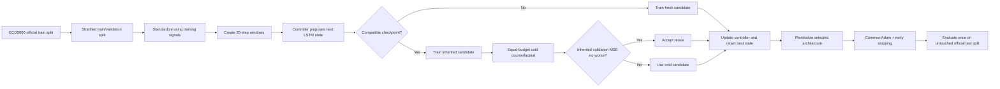

# Bellman-Guided Warm Search for ECG Forecasting

> Reproducible experiments for learning to forecast the next sample of an ECG
> signal while searching over LSTM architectures with a Bellman/Q-learning
> controller and optional checkpoint reuse.

[](./paper.pdf)
[](https://www.timeseriesclassification.com/description.php?Dataset=ECG5000)
[](https://pytorch.org/)
[](./lstm_bellman_reviewer_revision.ipynb)

This repository accompanies the paper **“Bellman-Guided Warm Search for ECG
Forecasting.”** It contains the paper and the complete reviewer-revision
experiment notebook used for the ECG5000 study.

<details>
<summary><strong>Table of contents</strong></summary>

- [At a glance](#at-a-glance)
- [Research question](#research-question)
- [Method](#method)
- [Repository layout](#repository-layout)
- [Quick start](#quick-start)
- [Experiment configuration](#experiment-configuration)
- [Reported results](#reported-results)
- [Reproducibility protocol](#reproducibility-protocol)
- [Limitations and interpretation](#limitations-and-interpretation)
- [Citation](#citation)

</details>

## At a glance

The notebook evaluates whether warm-starting neighboring LSTM candidates from a
previous checkpoint is useful during architecture search. It compares:

| Component | Compared settings |
|---|---|
| Search controller | Q-learning vs. random actions |
| Search optimizer | Adam vs. SGD |
| Checkpoint policy | Validation-gated reuse, direct reuse, or cold start |
| Forecaster | One-dimensional LSTM with a linear prediction head |
| Dataset | Official ECG5000 train/test split |
| Evaluation | Five seeds: `11, 22, 33, 44, 55` |

The primary gated warm-start arm is deliberately compared with a cold-start
control. The final model for every arm is reinitialized and trained with the
same Adam/early-stopping protocol, so the comparison isolates the search phase
from the final training phase.

## Research question

Can a Bellman-guided search reduce the cost of exploring LSTM architectures by
reusing compatible weights, without allowing negative transfer to degrade
validation performance?

The search state is:

```text
(hidden units, number of LSTM layers, dropout)
```

The controller chooses one of seven local actions:

```text
increase/decrease hidden size
increase/decrease layer count
increase/decrease dropout
keep the current state
```

## Method



### Search space

- Hidden size: `32, 64, 128`
- LSTM layers: `1, 2`
- Dropout: `0.0, 0.2, 0.4`
- Initial state: `(64, 1, 0.0)`
- Search episodes: `12`
- Candidate-training epochs per episode: `3`
- Batch size: `512`
- Learning rate: `1e-3`

## Repository layout

```text
.
├── lstm_bellman_reviewer_revision.ipynb  # experiment and analysis notebook
├── paper.pdf                             # accompanying paper
└── README.md                             # project documentation
```

Running the notebook creates a `reviewer_revision_results/` directory containing:

```text
reviewer_ablation_per_seed.csv
reviewer_ablation_episodes.csv
reviewer_final_training_history.csv
reviewer_ablation_summary.csv
```

## Quick start

### Option A: Google Colab

1. Open [`lstm_bellman_reviewer_revision.ipynb`](./lstm_bellman_reviewer_revision.ipynb).
2. Upload it to [Google Colab](https://colab.research.google.com/).
3. Install the dependencies in a notebook cell:

   ```python
   %pip install numpy pandas requests scikit-learn torch
   ```

4. Run all cells.

The notebook downloads the official ECG5000 `.ts` files at runtime from the
public Hugging Face mirror configured in `URLS`.

### Option B: Local Jupyter

```bash
git clone https://github.com/shovo896/Bellman-Guided-warm-search-for-ECG-forcasting-.git
cd Bellman-Guided-warm-search-for-ECG-forcasting-

python -m venv .venv
source .venv/bin/activate        # Windows: .venv\Scripts\activate
python -m pip install --upgrade pip
python -m pip install jupyter numpy pandas requests scikit-learn torch
jupyter notebook lstm_bellman_reviewer_revision.ipynb
```

> **Runtime note:** the full paper configuration runs five seeds across five
> experimental arms. A GPU is recommended. The notebook automatically uses
> CUDA when available and otherwise falls back to CPU.

## Experiment configuration

The final execution cell exposes two modes:

### Full paper run

```python
RUN_MODE = "paper"
```

This runs all five seeds and all five primary arms, writes CSV summaries, and
reports aggregate means with 95% Student-t confidence intervals.

### Fast smoke run

```python
RUN_MODE = "smoke"
```

This uses one seed, two search episodes, fewer samples, and a short final
training budget. Use it to verify that dependencies, data download, model
construction, and result writing work before starting the full experiment.

## Reported results

The following values are the aggregate results embedded in the executed
notebook, averaged over five seeds. Lower MSE/MAE/RMSE is better; higher R² is
better.

| Experimental arm | Test MSE | Test RMSE | Test MAE | Test R² | Mean updates |
|---|---:|---:|---:|---:|---:|
| Q + Adam + gated reuse | 0.023549 | 0.153409 | 0.089197 | 0.961610 | 4,128 |
| Random + Adam + gated reuse | 0.024431 | 0.156158 | 0.090570 | 0.960172 | 4,224 |
| Q + SGD + gated reuse | 0.024968 | 0.157980 | 0.091690 | 0.959297 | 4,184 |
| **Q + Adam + cold start** | **0.022879** | **0.151243** | **0.088325** | **0.962702** | **3,320** |
| Q + Adam + direct reuse | 0.023798 | 0.154203 | 0.089569 | 0.961204 | 3,344 |

The embedded results show that the cold-start control performs slightly better
than the gated warm-start arm on this configuration. This repository therefore
does **not** claim that warm reuse is universally superior; it provides the
controlled implementation and ablations needed to study when reuse helps or
fails.

<details>
<summary><strong>What does “gated reuse” mean?</strong></summary>

When a candidate architecture has compatible parameter shapes, the notebook
trains both an inherited candidate and a fresh candidate for the same update
budget. The inherited checkpoint is retained only when its validation MSE is no
worse. The official test split is not used for this decision.

</details>

## Reproducibility protocol

The notebook is designed to avoid test leakage during model search:

1. The official ECG5000 training split is divided into train and validation
   subsets using a seed-controlled split.
2. Standardization is fit on the training signals and applied to validation and
   test signals.
3. Signals are converted into one-step-ahead windows with a lookback of `20`.
4. Architecture search uses training data and validation MSE only.
5. The selected architecture is reinitialized and retrained from scratch.
6. Early stopping uses validation MSE only.
7. The untouched official test partition is evaluated once per arm and seed.

Deterministic seeds are set for Python, NumPy, and PyTorch. The notebook also
stores per-seed summaries, episode-level search logs, and final-training
histories for downstream analysis.

## Limitations and interpretation

- The study uses one benchmark dataset and one-step-ahead forecasting.
- The default paper run caps the sampled training and validation windows for
  practical runtime.
- The search controller is tabular and uses a small, discrete state space.
- Warm-start acceptance is a validation-based safeguard, not a proof that
  negative transfer cannot occur.
- Runtime depends on hardware, PyTorch version, and data-download speed.

These results should be read as a controlled ECG5000 ablation study rather than
as evidence that checkpoint reuse will improve every forecasting workload.

## Citation

If you use this repository, please cite the accompanying paper available in
[`paper.pdf`](./paper.pdf). Add the final bibliographic metadata here when the
paper has a public venue or DOI.

```bibtex
@article{bellmanGuidedWarmSearchECG,
  title   = {Bellman-Guided Warm Search for ECG Forecasting},
  author  = {See the author list in the accompanying paper},
  note    = {Code and experiments: https://github.com/shovo896/Bellman-Guided-warm-search-for-ECG-forcasting-}
}
```

## License

No license file is currently included in this repository. Add a license before
redistributing the code or derivative results.
